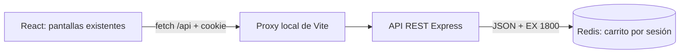

# Escenario 3: carrito temporal con Redis

## A. Objetivo

Conservar la selección de vuelos y hoteles al recargar mediante una base de
datos Clave-Valor. Cada sesión tiene su carrito, que caduca tras 30 minutos
sin interacción. No incluye pagos ni autenticación de usuarios. Los escenarios
1 y 2 quedan fuera de estos cambios.

## B. Tecnologías

React 19 y Vite 7 para la interfaz existente; Node.js 22.12+ (se usó 24.18.0),
Express 5, `cookie-parser`, cliente `redis` 5 y Redis 7.4 con Docker Compose.
Las versiones instaladas están fijadas en los dos `package-lock.json`.
Las pruebas de integración utilizan `node:test` sin un framework adicional.

## C. Interfaces existentes

- **Inicio:** bienvenida, paisaje con CSS y accesos a los catálogos.
- **Vuelos:** cinco rutas, fecha, aerolínea y precio por boleto.
- **Hoteles:** cinco alojamientos, descripción y precio por noche.
- **Carrito:** productos, eliminación, contador, total y estado vacío.

Se conservan los verdes, tarjetas, tipografía, navegación y adaptación a móvil
de Ricardo. Se añaden «Vaciar carrito», un aviso de carga y un mensaje con
«Consultar de nuevo» si hay errores. El contador muestra «…» mientras se
consulta o se desconoce el estado; un error no se representa como cero.

## D. Modelo Clave-Valor

Cada clave `carrito:sesion:<id>` contiene un **string JSON** con `productos`.
El identificador tiene 32 bytes aleatorios (64 caracteres hexadecimales),
generado por el servidor. Viaja en una cookie de sesión firmada,
`carrito_sesion`, con `HttpOnly`, `SameSite=Lax` y ruta `/api`.
Una cookie sin firma válida se sustituye por una sesión nueva. El navegador
no puede elegir un identificador arbitrario de usuario o carrito.

En desarrollo HTTP se usa `COOKIE_SECURE=false`; con HTTPS se debe usar `true`.
`SESSION_SECRET` se genera localmente en `.env`, excluido de Git. No se guardan
datos personales. Cerrar la sesión del navegador puede hacer perder el acceso
al carrito aunque su clave siga vigente; algunos navegadores restauran las
cookies de sesión. Las pestañas del mismo perfil comparten cookie y carrito.

## E. Ejemplo de Key y Value

Key de ejemplo (el sufijo real es aleatorio):

```text
carrito:sesion:8bd90dce1cb37e4f68ad1a2b34e5906c732d91e4c88f7a8e0b319da6c1f5e204
```

Value:

```json
{
  "productos": [
    { "id": "vuelo-1", "tipo": "vuelo", "nombre": "Ciudad de México → Cancún", "precio": 2450 },
    { "id": "hotel-1", "tipo": "hotel", "nombre": "Casa del Mar", "precio": 1850 }
  ]
}
```

La API devuelve además `total: 4300` y `ttlSegundos: 1800`. El servidor calcula
el total, que no se duplica dentro del valor almacenado. Cada selección es un
boleto o una noche: cantidad fija de uno.

## F. Justificación de Redis

Se accede al carrito directamente mediante una clave conocida. Redis ofrece
lectura y escritura en memoria y expiración automática, apropiadas para una
selección temporal. Recuperarlo no requiere consultas de destinos ni recorrer
amigos; esas necesidades pertenecen a los otros escenarios.

## G. Sin relaciones complejas ni esquema rígido

Se obtiene el carrito completo por su clave. No hay tablas, uniones ni
relaciones entre carritos. JSON permite representar juntos vuelos y hoteles.
Esto no elimina la validación: la API comprueba los identificadores y obtiene
`tipo`, `nombre` y `precio` del catálogo existente en `intefaz/src/datos.js`.
El servidor importa ese archivo, que no se modifica en este escenario.

## H. TTL e inactividad

Todas las operaciones válidas ejecutan `SET clave valor EX 1800`. Consultar,
agregar (incluso un duplicado), eliminar y vaciar renuevan los 1800 segundos.
El carrito vacío se almacena como `{"productos":[]}` con TTL. Si la clave ya
no existe, la siguiente operación parte de un carrito vacío.

Navegar entre pantallas, recargar, volver a la pestaña o usar los botones del
carrito provoca una petición. No hay sondeo periódico que prolongue la vida
de un carrito abandonado. Tras 30 minutos sin peticiones, React oculta su copia
y solicita volver a consultar. `redis-cli GET` y `TTL` no renuevan la caducidad.

Un pequeño script Lua hace lectura, modificación y renovación atómicas para
que peticiones simultáneas no sobrescriban selecciones ni creen duplicados.
No se necesitan módulos adicionales de Redis.

## I. Arquitectura y API



| Método | Ruta | Operación |
| --- | --- | --- |
| GET | `/api/carrito` | Consultar y renovar vigencia |
| POST | `/api/carrito/productos` | Agregar con `{"id":"vuelo-1"}` |
| DELETE | `/api/carrito/productos/:id` | Eliminar un producto |
| DELETE | `/api/carrito` | Vaciar el carrito |

Al agregar se acepta solo `id`. Se rechazan precios, cantidades, campos extra,
JSON inválido y productos inexistentes con 400; solicitudes grandes con 413;
orígenes ajenos con 403; rutas desconocidas con 404. Redis desconectado produce
503. No hay caché HTTP de respuestas. Vite sirve de proxy bajo el mismo origen
para que no sea necesario habilitar CORS.

## J. Ejecutar desde cero en Ubuntu Linux

1. Instalar Git y Node.js 22.12+ con npm. Si falta Docker, seguir la
   [instalación oficial para Ubuntu](https://docs.docker.com/engine/install/ubuntu/),
   incluyendo Compose. Verificar:

   ```sh
   node --version
   npm --version
   docker --version
   docker compose version
   ```

2. Obtener el repositorio y entrar en la rama de trabajo:

   ```sh
   git clone https://github.com/Ricardo2099/Practica-Dise-ando-con-NoSQL.git
   cd Practica-Dise-ando-con-NoSQL
   git switch feat/escenario-3-clave-valor
   ```

   Si ya tienes el proyecto, entra en su carpeta y verifica con
   `git branch --show-current`. Estos cambios deben existir en tu copia local
   para ejecutar el backend; todavía no se han publicado en GitHub.

3. Desde la raíz, descargar e iniciar Redis:

   ```sh
   docker compose up -d --wait redis
   docker compose ps
   docker compose exec redis redis-cli ping
   ```

   Debe responder `PONG`. Solo se publica `127.0.0.1:6379`. Si tu instalación
   de Docker requiere permisos, usa `sudo` en esos comandos según tu equipo.
   No necesitas instalar `redis-cli` en Ubuntu: viene en el contenedor.
   Si 6379 está ocupado, usa `REDIS_PORT=6380 docker compose up -d --wait redis`
   y configura `REDIS_URL=redis://127.0.0.1:6380/0` en el paso siguiente.

4. Preparar el backend en la terminal 1:

   ```sh
   cd backend
   npm ci
   cp .env.example .env
   node -e "console.log(require('node:crypto').randomBytes(32).toString('hex'))"
   ```

   Copia el resultado en `SESSION_SECRET=` dentro de `backend/.env` con VS Code.
   No vuelvas a copiar el ejemplo si ya tienes `.env` configurado. Inicia:

   ```sh
   npm start
   ```

   API: `http://127.0.0.1:3001`. `npm run dev` reinicia al editar. Si Redis
   falla, la API devuelve 503 y reintenta la conexión. Conserva el secreto
   al reiniciar Node para mantener las sesiones.

5. Desde la raíz, en otra terminal, iniciar React:

   ```sh
   cd intefaz
   npm ci
   npm run dev
   ```

   Abrir **http://localhost:5173**. Usar siempre ese hostname: `localhost` y
   `127.0.0.1` tienen cookies distintas. Si cambias el origen, ajusta
   `FRONTEND_ORIGIN` en `backend/.env`; si cambias el puerto de la API, ajusta
   también el proxy en `intefaz/vite.config.js`.

6. Desde la raíz, compilar y ejecutar pruebas:

   ```sh
   cd backend
   npm test
   cd ../intefaz
   npm run build
   ```

   Las pruebas necesitan Redis real e inician su propia API en un puerto libre.
   Usan claves `carrito:prueba:<aleatorio>:<sesion>` y limpian solo esas claves;
   no ejecutan `FLUSHDB` ni tocan carritos del navegador. Para ver la compilación,
   detener Vite y ejecutar `npm run preview` (también en localhost:5173).

7. Detener los servidores con Ctrl+C. Desde la raíz, `docker compose down`
   detiene Redis. No se habilitan AOF, snapshots ni un volumen persistente:
   reiniciar Redis borra las selecciones. Recargar el navegador o reiniciar
   solo Node conserva los datos mientras siga vigente el TTL.

## K. Comprobar el contenido con redis-cli

Agregar el primer vuelo y Casa del Mar desde la interfaz. Desde la raíz:

```sh
docker compose exec redis redis-cli --scan --pattern 'carrito:sesion:*'
docker compose exec redis redis-cli
```

En la consola de Redis, sustituir `<id>` por el sufijo de una clave obtenida:

```text
TYPE carrito:sesion:<id>
GET carrito:sesion:<id>
TTL carrito:sesion:<id>
```

`TYPE` debe indicar `string`; `GET` contiene ambos productos; `TTL` es positivo
y como máximo 1800. Esperar unos segundos y consultar `TTL`: disminuye.
Interactuar con el carrito y comprobar que vuelve cerca de 1800. Una ventana
privada debe tener otro carrito y otra clave.

Para demostrar expiración rápidamente, **solo sobre tu clave de prueba**:

```text
EXPIRE carrito:sesion:<id> 5
```

Esperar cinco segundos sin tocar la web. `TTL` devuelve `-2` y `GET`, `(nil)`.
La próxima consulta de la web crea un carrito vacío con TTL 1800.

## L. Pruebas y resultados

Verificación del 12 de noviembre de 2026, con Redis real en Docker,
Node 24.18.0 y Chrome sin interfaz visible:

| Verificación | Resultado |
| --- | --- |
| `backend: npm test` | 14 pruebas, 14 correctas |
| `intefaz: npm run build` | Compilación correcta |
| Agregar vuelo y hotel / duplicado | 2 productos, $4300; duplicado no aumenta el contador |
| Eliminar vuelo / vaciar | 1 producto, $1850; después arreglo vacío y total 0 |
| Diez productos, incluso solicitudes simultáneas | 10 productos, $19010 |
| TTL de todas las operaciones | Se renueva a 1800 segundos |
| Expiración en Redis | Clave eliminada al vencer; misma sesión vuelve vacía |
| Sesiones distintas / cookies manipuladas | Carritos separados; firma inválida crea otra sesión |
| Precios, cantidades, JSON y origen inválidos | Rechazados correctamente |
| Cliente Redis desconectado | 503 sin productos ni total ficticios |
| Recarga real de Chrome | Conservó 2 productos y total $4300 |
| `redis-cli GET` y `TTL` de ese carrito | JSON con 2 productos; TTL observado: 1800 |
| Cookie en Chrome | HttpOnly, SameSite=Lax e inaccesible desde `document.cookie` |
| Otro contexto de Chrome | Carrito independiente y vacío |
| Cuatro pantallas a 320, 390, 768 y 1280 px | Sin desbordamiento horizontal |
| Fallo de red simulado en Chrome | Oculta total y estado vacío; reintentar recupera los datos |
| Redis detenido y reiniciado realmente | Error visible, API 503 y recuperación; Redis reinicia vacío |
| Ejecución de React en Chrome | Sin errores de ejecución |

La prueba de expiración reduce una clave a 50 ms para comprobar el mecanismo
real; no se afirma haber esperado 30 minutos. Las comprobaciones de navegador
se ejecutaron con Playwright Core temporal y Chrome instalado, sin añadir
una dependencia de navegador al proyecto. Las pruebas reproducibles de la API
quedan en `backend/test/carrito.test.js`. No se probaron otros navegadores ni
dispositivos físicos.

## M. Evidencias para entregar

Conservar o capturar:

1. Las cuatro pantallas con los catálogos originales.
2. Carrito con vuelo y hotel, contador 2 y total $4300 antes y después de recargar.
3. Terminal con `GET` del JSON y `TTL` cercano a 1800.
4. Dos consultas de TTL y su renovación al interactuar.
5. Ventana privada con otro carrito y dos claves en Redis.
6. Eliminación, carrito vacío y error al detener Redis.
7. Terminal con las 14 pruebas y la compilación correctas.

Capturas reales incluidas:

- [Carrito con vuelo y hotel](evidencias/carrito-persistente.png).
- [Carrito vacío](evidencias/carrito-vacio.png).
- [Carrito en móvil](evidencias/carrito-movil.png).
- [Error con Redis detenido](evidencias/error-redis.png).

## Archivos y Git

`backend/src/app.js` define API y sesión; `catalogo.js` obtiene los productos;
`redis-store.js` implementa almacenamiento y TTL; `server.js` conecta Redis.
`intefaz/src/useCarrito.js` sincroniza React. `compose.yaml` prepara Redis local.
No se cambiaron `datos.js`, `Inicio.jsx` ni los archivos de los otros escenarios.

Cambios sin commit en `feat/escenario-3-clave-valor`. Después de revisarlos,
desde la raíz:

```sh
git branch --show-current
git status --short
git diff
git add .gitignore compose.yaml backend docs intefaz/README.md intefaz/vite.config.js intefaz/src
git diff --cached --stat
git commit -m "feat(carrito): persistir sesiones en Redis con TTL"
```

El commit propuesto contiene implementación, pruebas y documentación del mismo
escenario. `.env`, dependencias y compilaciones quedan excluidos de Git.
No se ejecutaron commits, push, Pull Request ni merge.

Referencias: [node-redis](https://redis.io/docs/latest/clients/nodejs/),
[scripts atómicos de Redis](https://redis.io/docs/latest/develop/programmability/eval-intro/)
y [cookies en Express](https://expressjs.com/en/5x/api/response/).
